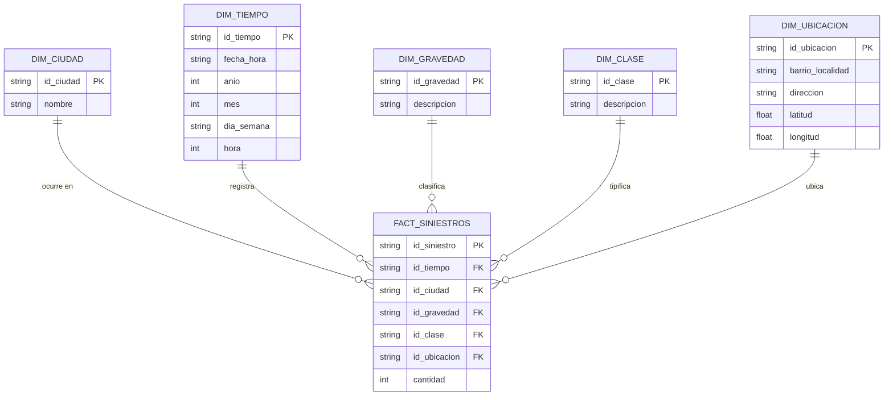

# Asesoría del Proyecto Final — Respuesta a los temas de la sesión

**Proyecto:** AccidentAPP — Dashboard gerencial de siniestralidad vial (Univalle)
**Fecha de la asesoría:** 2026-10-20
**Documento preparado:** 2026-10-19

Este documento responde, punto por punto, los temas solicitados para la asesoría.

---

## 1. Retroalimentación de la entrega 1

La retroalimentación escrita de la entrega 1 no está registrada en el repositorio,
por lo que no se transcribe aquí. Para la sesión se presenta el estado de los
compromisos y los avances verificables desde esa entrega:

| Frente | Estado actual | Evidencia |
|---|---|---|
| Datos consolidados | 1.194.608 registros de 7 fuentes, normalizados y cargados | `Diagnostico.ipynb`, celdas 2 y 3 |
| Motor de almacenamiento | MongoDB local, base `db_siniestralidad_vial` | `backend/app/database/mongo_client.py` |
| Esquema de BD | Estrella desnormalizado (documento de hechos con dimensiones embebidas) | Sección 2.3 de este documento |
| Carga inicial | Rutina ETL + carga por lotes de 50.000 documentos | `Diagnostico.ipynb`, celdas 2 y 3 |
| Backend | FastAPI con JWT, roles, dashboard descriptivo y predicción | `backend/app/` |
| Frontend | Login, dashboard redimensionable, filtros, tema claro/oscuro | `frontend/src/` |
| Modelo ML | Random Forest de severidad entrenado y serializado | `backend/app/ml/models/*.pkl` |

> Completar en la sesión: observaciones puntuales recibidas y su acción asociada.

---

## 2. Avance en el desarrollo de la App

### 2.1 Dataset depurado

Se consolidaron **7 archivos** de 5 ciudades (Bucaramanga, Barranquilla, Envigado,
Bogotá y Medellín) más un consolidado nacional 2016–2024:

| # | Archivo fuente | Ciudad | Registros | Formato |
|---|---|---|---:|---|
| 1 | `3._Accidentes_de_Transito_ocurridos_en_el_Municipio_de_Bucaramanga_20260926.csv` | Bucaramanga | 39.193 | CSV (24 columnas) |
| 2 | `Accidentalidad_en_Barranquilla_20260926.csv` | Barranquilla | 28.523 | CSV (11 columnas) |
| 3 | `Accidentalidad_Municipio_de__Envigado_20260926.csv` | Envigado | 89.826 | CSV (17 columnas) |
| 4 | `historico_siniestros_bogota_d.c_-.csv` | Bogotá | 199.146 | CSV (16 columnas) |
| 5 | `incidentes_viales.csv` | Medellín | 270.765 | CSV (18 columnas) |
| 6 | `siniestralidad_2016_2024.csv` | Nacional / indefinido | 371.003 | CSV (10 columnas, separador autodetectado, latin-1) |
| 7 | `siniestros_viales_consolidados_bogota_dc.xlsx` | Bogotá | 196.152 | Excel (10 columnas) |
| | **Total** | | **1.194.608** | |

#### Esquema canónico resultante

Todas las fuentes se mapearon a un mismo conjunto de campos:

| Campo | Tipo | Descripción |
|---|---|---|
| `id_siniestro` | string | Identificador de la fuente (no garantiza unicidad global) |
| `ciudad` | string | Bucaramanga, Barranquilla, Envigado, Bogotá, Medellín o Nacional/Indefinido |
| `fecha_hora` | string | Fecha y hora del evento (se serializa como texto) |
| `anio` | int | Año del evento (`0` cuando no se reportó) |
| `mes` | int / string | Mes del evento (la fuente no siempre lo entrega como número) |
| `dia_semana` | string | Día normalizado en español y mayúsculas |
| `hora` | int | Hora (0–23) |
| `gravedad` | string | `SOLO DAÑOS`, `CON HERIDOS`, `CON MUERTOS`, `OTRO` |
| `clase_accidente` | string | `CHOQUE`, `ATROPELLO`, `VOLCAMIENTO`, `CAIDA OCUPANTE`, `OTRO` |
| `direccion` | string | Dirección reportada |
| `barrio_localidad` | string | Barrio, comuna o localidad |
| `latitud` | float | Coordenada (nula en la mayoría de fuentes) |
| `longitud` | float | Coordenada (nula en la mayoría de fuentes) |

#### Reglas de depuración aplicadas

1. **Gravedad:** normalización por palabra clave a 4 categorías
   (`HERID` → CON HERIDOS; `MUERT`/`FATAL` → CON MUERTOS; `DAÑO` → SOLO DAÑOS; resto → OTRO).
2. **Clase de accidente:** normalización por palabra clave a 5 categorías.
3. **Días:** traducción de inglés a español, mayúsculas y limpieza; vacíos → `NO REPORTADO`.
4. **Año:** se eliminan caracteres no numéricos, se convierte a entero; no reportado → `0`.
5. **Fechas:** conversión con `pd.to_datetime` y serialización a texto para BSON/JSON.
6. **Campos inexistentes en la fuente:** se completan con `NaN` (coordenadas, dirección o barrio según el caso).
7. **Consolidación:** `pd.concat` de las 7 fuentes en un único DataFrame.

#### Limitaciones conocidas del dataset

- **Años inválidos:** el ETL deja valores como `20140` porque solo elimina caracteres no numéricos; el
  entrenamiento del modelo los descarta al extraer el año de `fecha_hora`. Pendiente acotar a 2000–2030 en el ETL.
- **Ciudad "Nacional / Indefinido":** el archivo 2016–2024 no identifica municipio; puede solaparse con
  registros de las otras fuentes y producir doble conteo.
- **Dos fuentes de Bogotá:** el CSV histórico y el Excel consolidado pueden contener los mismos eventos.
  No se aplicó deduplicación.
- **`id_siniestro`:** varios orígenes usan identificadores generados (`BAQ_i`, `BOG_XLS_i`) y no existe
  una clave única global entre fuentes.
- **Cobertura desigual:** Bucaramanga no trae clase de accidente (se marca `OTRO`); Barranquilla no trae
  barrio; solo Bogotá y Medellín aportan coordenadas.
- **Fechas como texto:** limita comparaciones y rangos; se recomienda guardar además un tipo `Date` de BSON.

---

### 2.2 Definición del motor de almacenamiento

**Motor seleccionado: MongoDB (base de datos documental NoSQL).**

| Aspecto | Definición |
|---|---|
| Motor | MongoDB, ejecución local en `mongodb://localhost:27017/` |
| Base de datos | `db_siniestralidad_vial` |
| Colecciones | `siniestros` (hechos) y `usuarios` (autenticación) |
| Driver | `pymongo` con conexión singleton |
| Documento | BSON: un accidente = un documento con sus atributos |
| Consultas analíticas | Pipelines de agregación (`$match`, `$group`, `$sort`, `$limit`) |
| Configuración | URI parametrizable con la variable de entorno `MONGO_URI` |

#### Justificación

- **Volumen:** 1.194.608 documentos; MongoDB los maneja sin problema con índices adecuados.
- **Heterogeneidad:** las 7 fuentes tienen columnas distintas; el modelo documental admite campos
  opcionales sin migraciones ni tablas vacías.
- **Analítica:** el dashboard agrupa por ciudad, gravedad, clase, año y día; los pipelines de agregación
  resuelven esto directamente y el backend ya los usa.
- **Integración:** `pymongo` + Python + FastAPI es directo, y los resultados se serializan a JSON para React.
- **Carga masiva:** `insert_many` por lotes de 50.000 documentos.

#### Alternativa considerada

**PostgreSQL con esquema estrella relacional.** Ofrece mayor integridad referencial y un modelo más formal,
pero exige más ETL, `JOIN` en cada consulta y mayor complejidad para un dataset que cambia de forma entre
fuentes. Se descartó para esta entrega.

#### Índices recomendados (pendiente de crear)

```javascript
db.siniestros.createIndex({ ciudad: 1, anio: 1 })
db.siniestros.createIndex({ gravedad: 1 })
db.siniestros.createIndex({ clase_accidente: 1 })
db.siniestros.createIndex({ dia_semana: 1 })
db.siniestros.createIndex({ hora: 1 })
db.siniestros.createIndex({ barrio_localidad: 1 })
db.siniestros.createIndex({ fecha_hora: 1 })
```

Sin estos índices, los filtros del dashboard hacen recorrido completo de la colección.

---

### 2.3 Esquema y diagrama de la base de datos

**Modelo elegido: Estrella (desnormalizado).**

Se eligió un esquema estrella porque el sistema es analítico (BI): las consultas agregan hechos por
dimensiones (ciudad, tiempo, gravedad, clase y ubicación), no se realizan transacciones fila a fila.
El copo de nieve añadiría colecciones y búsquedas extra sin beneficio para estas consultas; el modelo
relacional transaccional normalizado está pensado para OLTP y obligaría a múltiples `JOIN`.

En MongoDB el esquema se implementa de forma **desnormalizada**: una sola colección de hechos,
`siniestros`, con los atributos de las dimensiones embebidos en cada documento. Esto evita búsquedas
adicionales y es el patrón habitual para analítica documental. El modelo lógico es:



#### Correspondencia con la implementación física actual

| Elemento lógico | Implementación en MongoDB |
|---|---|
| `FACT_SINIESTROS` | Colección `siniestros` |
| `DIM_TIEMPO` | Campos `fecha_hora`, `anio`, `mes`, `dia_semana`, `hora` dentro del documento |
| `DIM_CIUDAD` | Campo `ciudad` |
| `DIM_GRAVEDAD` | Campo `gravedad` |
| `DIM_CLASE` | Campo `clase_accidente` |
| `DIM_UBICACION` | Campos `barrio_localidad`, `direccion`, `latitud`, `longitud` |
| Medida | `cantidad = 1` por documento (conteo de siniestros) |

Ejemplo de documento almacenado:

```json
{
  "id_siniestro": "123456",
  "ciudad": "Bogotá",
  "fecha_hora": "2023-05-14 18:30:00",
  "anio": 2023,
  "mes": 5,
  "dia_semana": "DOMINGO",
  "hora": 18,
  "gravedad": "CON HERIDOS",
  "clase_accidente": "CHOQUE",
  "direccion": "CALLE 80 CON AUTOPISTA",
  "barrio_localidad": "ENGATIVÁ",
  "latitud": 4.711,
  "longitud": -74.072
}
```

> Si se requiere el esquema estrella estricto en la exposición, esta correspondencia permite explicar
> las dimensiones; no es necesario crear colecciones `dim_*` para el alcance actual.

---

### 2.4 Rutina implementada para la carga inicial del dataset

**Ubicación:** `Diagnostico.ipynb`, celdas 2 (ETL y consolidación) y 3 (limpieza final y carga).

#### Flujo

```text
1. Leer las 7 fuentes (CSV y Excel)
2. Renombrar y mapear columnas al esquema canónico
3. Normalizar gravedad, clase, días y año
4. Concatenar en un único DataFrame (1.194.608 filas)
5. Conectar a MongoDB (db_siniestralidad_vial)
6. Eliminar la colección 'siniestros' si existe (collection.drop())
7. Convertir el DataFrame a lista de diccionarios
8. Insertar en lotes de 50.000 con insert_many()
9. Verificar el total con count_documents({})
```

#### Fragmento principal de la carga

```python
client = MongoClient("mongodb://localhost:27017/")
db = client["db_siniestralidad_vial"]
collection = db["siniestros"]
collection.drop()

records = df_mongo.to_dict("records")
batch_size = 50000

for i in range(0, len(records), batch_size):
    collection.insert_many(records[i:i + batch_size])
    print(f"Insertados {min(i + batch_size, len(records)):,} registros")

print(collection.count_documents({}))
```

#### Resultado de la ejecución

- Registros consolidados: **1.194.608**
- Documentos insertados: **1.194.608**
- Lotes: 24 (23 de 50.000 + 1 de 44.608)
- Salida verificada en la celda 3 del notebook.

#### Cómo reproducirla

1. Ubicar los 7 archivos fuente en la raíz del proyecto (están excluidos de Git por `*.csv` y `*.xlsx`).
2. Tener MongoDB en ejecución en `localhost:27017`.
3. Instalar dependencias: `pip install pandas openpyxl pymongo`.
4. Ejecutar las celdas 2 y 3 de `Diagnostico.ipynb` en orden.

#### Limitaciones de la rutina actual

- No es idempotente por fuente: `collection.drop()` borra todo y recarga desde cero.
- Los nombres de archivo y la ruta están codificados; no usa argumentos ni variables de entorno.
- No crea índices ni valida duplicados antes de insertar.
- Carga todo el consolidado en memoria (DataFrame) antes de escribir.
- No registra log persistente ni checksum de las fuentes.
- Los identificadores generados (`BAQ_i`, `BOG_XLS_i`) no garantizan unicidad global.

#### Mejora propuesta (siguiente iteración)

Extraer las celdas a `backend/scripts/load_data.py` con:

- argumentos `--data-dir` y `--drop` (recarga explícita, no implícita),
- deduplicación por `(ciudad, id_siniestro, fecha_hora)`,
- acotamiento de años a 2000–2030,
- creación de índices al finalizar,
- resumen de cargados/descartados y log a archivo.

---

## 3. Resumen para la asesoría

| Tema solicitado | Respuesta |
|---|---|
| Dataset depurado | 7 fuentes → 1.194.608 registros con esquema canónico de 13 campos |
| Motor de almacenamiento | MongoDB documental, base `db_siniestralidad_vial`, colección `siniestros` |
| Esquema y diagrama | Estrella desnormalizado; dimensiones embebidas (diagrama en la sección 2.3) |
| Rutina de carga inicial | ETL en `Diagnostico.ipynb` + `insert_many` por lotes de 50.000 con verificación de total |

## 4. Próximos pasos

1. Registrar la retroalimentación de la entrega 1 y cerrar sus acciones.
2. Corregir años inválidos y evaluar deduplicación Bogotá / consolidado nacional.
3. Crear índices en MongoDB y medir el tiempo de respuesta del dashboard.
4. Extraer la rutina de carga a un script versionado y reproducible.
5. Conectar `/api/v1/dashboard/predictive` a datos reales en lugar de valores fijos.
6. Añadir pruebas automatizadas al backend.
